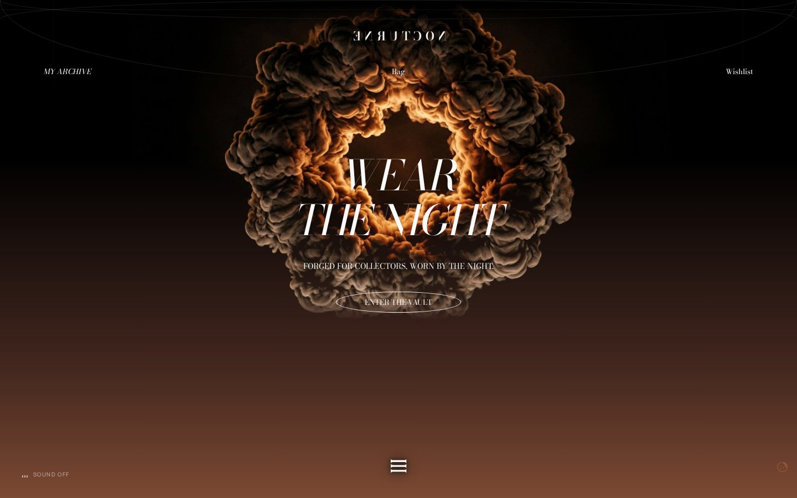
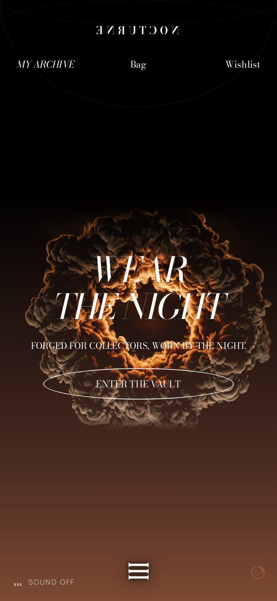
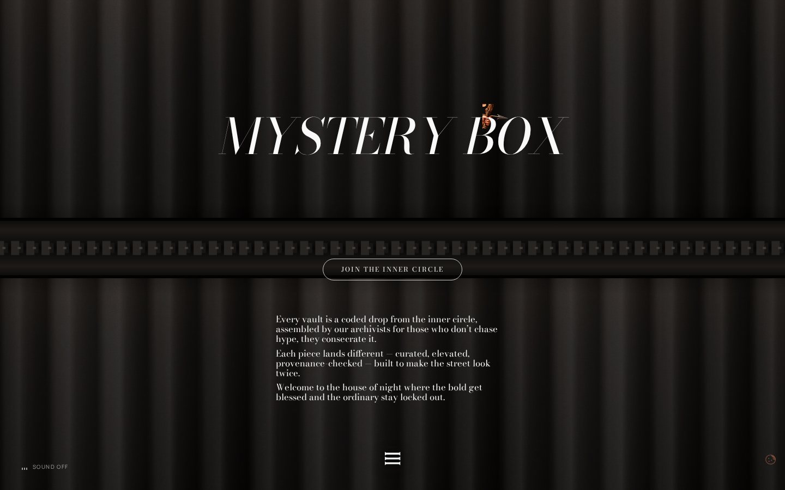
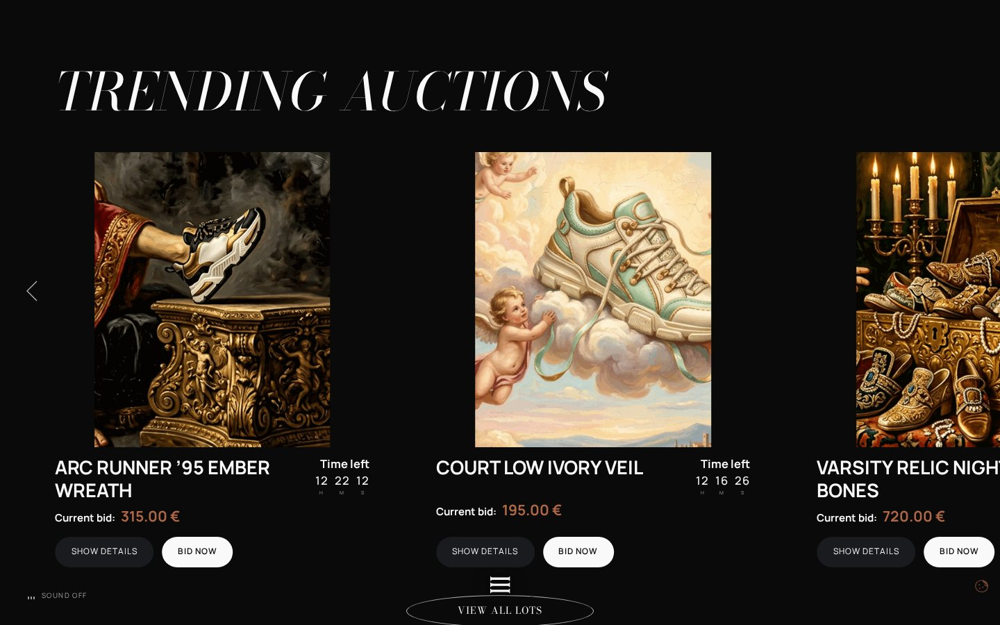
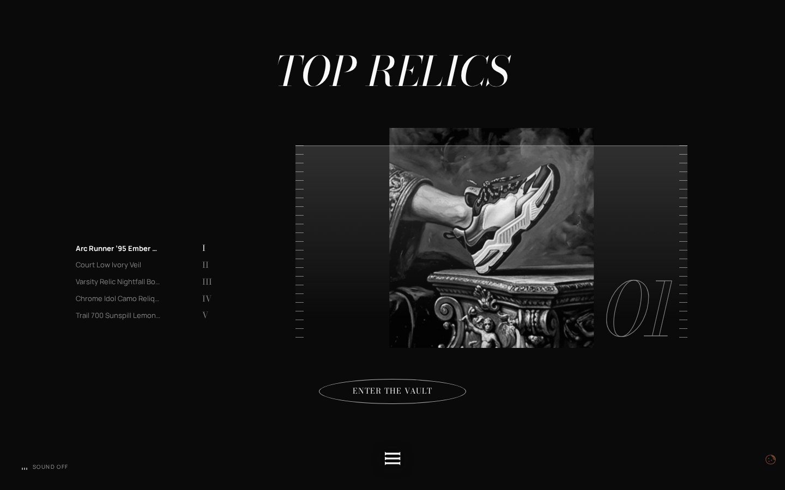
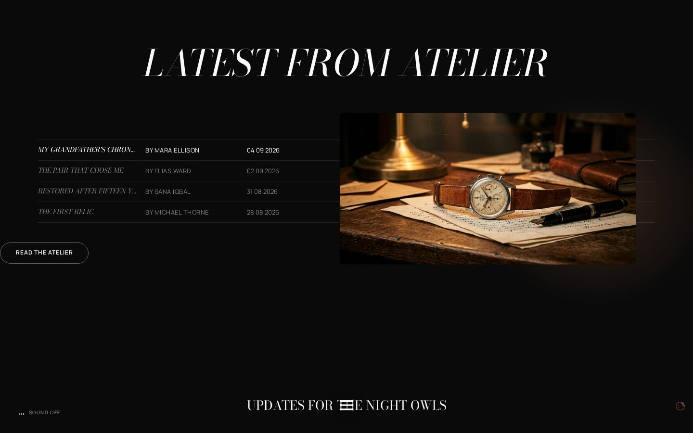
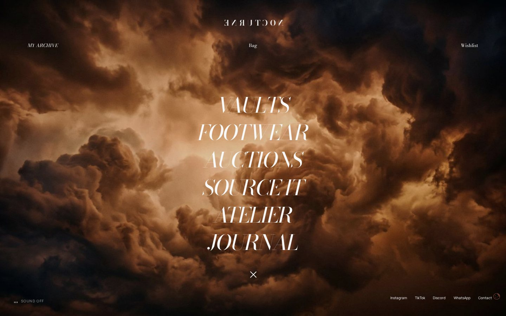

<div align="center">

<!-- ═══════════════ ANIMATED WAVE HEADER ═══════════════ -->


<!-- ═══════════════ TYPING RAINBOW TITLE ═══════════════ -->
<a href="index.html">
  
</a>

<br/>

<!-- ═══════════════ RAINBOW ANIMATED BADGES ═══════════════ -->
<picture>
  <source media="(prefers-color-scheme: dark)" srcset="https://readme-typing-svg.demolab.com?font=Inter&size=13&pause=100000&color=F9F9F9&center=true&vCenter=true&width=540&height=26&lines=HTML5+%C2%B7+CSS3+%C2%B7+Vanilla+JS+%C2%B7+GSAP+%C2%B7+ScrollTrigger+%C2%B7+Lenis+%C2%B7+Swiper+%C2%B7+Three.js" />
  
</picture>

<br/><br/>


<br/><br/>

<!-- ═══════════════ RAINBOW DIVIDER ═══════════════ -->

<a href="#-the-house"></a>

</div>

<!-- ═══════════════ TABLE OF CONTENTS ═══════════════ -->
<h2 align="center">Inside the House</h2>

<div id="inside-the-house"></div>

<div align="center">

|                §                 | Section            | What you'll find                         |
| :------------------------------: | :----------------- | :--------------------------------------- |
|      **[01](#-the-house)**       | The House          | What Nocturne is, in one breath          |
|      **[02](#-the-rooms)**       | The Rooms          | Every on-page experience, one by one     |
| **[03](#-motion--sound-system)** | Motion & Sound     | Scroll engine, cursor, synthesised audio |
|        **[04](#-stack)**         | Stack              | The exact technology used                |
|     **[05](#-quick-start)**      | Quick Start        | Preview it in 30 seconds                 |
|      **[06](#-structure)**       | Structure          | File-by-file map                         |
|    **[07](#-make-it-yours)**     | Make it Yours      | Swap art, copy, palette, links           |
|  **[08](#-performance--a11y)**   | Performance & a11y | What was done & what to check            |
|       **[09](#-licence)**        | Licence            | MIT, fonts, generated art                |

</div>

<br/>

---

<div align="center">
  
</div>

## 🩸 The House

**Nocturne** is a single-page, scroll-driven house of _archived footwear_ — a template that behaves like a boutique: it opens with a preloader counting you in, dissolves into a cloud-ringed title, then takes you **sideways** through an oil-painted manifesto before unzipping a vault of relics.

It is deliberately **not** a portfolio grid. It's a mood.

> _"Rarity is a ritual."_

<div align="center">
  
</div>

<br/>

<table align="center">
<tr>
<td align="center" width="33%"><h3>🖤 Night-first</h3><p>Charcoal surfaces, parchment type,<br/>ember accents <code>#ad6646</code></p></td>
<td align="center" width="33%"><h3>🌀 Scroll-narrative</h3><p>Pinned horizontal manifesto,<br/>pinned vault unzip, parallax clouds</p></td>
<td align="center" width="33%"><h3>🔊 Hand-synthesised</h3><p>Every sound is generated live with<br/>the Web Audio API — zero mp3s</p></td>
</tr>
</table>

<br/>

---

<div align="center">
  
</div>

## 🖼️ A look inside

<div align="center">

<table>
<tr>
<td width="72%"></td>
<td width="28%"></td>
</tr>
<tr>
<td align="center"><sub><b>Hero · 1440 × 900</b> — shader cloud ring, feathered edges, mirrored wordmark</sub></td>
<td align="center"><sub><b>Hero · 390 × 844</b> — same art, recomposed</sub></td>
</tr>
</table>

<br/>


<sub><b>The Vault</b> — pleated curtains, zip teeth closed at the seam. Scroll to unseal.</sub>

<br/><br/>


<sub><b>Trending Auctions</b> — edge-bleeding Swiper, live H/M/S countdowns, bid modal</sub>

<br/><br/>


<sub><b>Top Relics</b> — five numbered rows, hover swaps the plate and drains the colour back in</sub>

<br/><br/>


<sub><b>Latest from Atelier</b> — four articles, each with its own preview plate</sub>

<br/><br/>


<sub><b>The Menu</b> — painted clouds, six italic links, ring cursor collapses into an X</sub>

<br/><br/>

<sub><b>Every frame above is the shipped template</b> — clouds, painters, chest and all.</sub>

</div>

---

<div align="center">
  
</div>

## 🚪 The Rooms

<details>
<summary><b>00 · Preloader & Hero</b> — counting you in, then a breathing cloud-ring</summary>

<br/>

- A full-screen radial veil counts **0 → 100 %**, then lifts.
- The headline rewrites itself while counting: **“Wear” → “Wearing The Night”** → descrambles back to **“Wear The Night”**. Hover it and a hand-painted marker-style lettering swaps in (`data-title`).
- The cloud ring is a **Three.js shader plane** — a noise-displaced, feathered-edge texture that rises on load (`uReveal`) and drifts toward your pointer.
- Header, menu button and sound control fade in only **after** the veil lifts.

</details>

<details>
<summary><b>01 · Mini Manifesto</b> — a pinned, sideways oil-painting gallery</summary>

<br/>

|             |                                                                                                                                        |
| :---------- | :------------------------------------------------------------------------------------------------------------------------------------- |
| **Trigger** | `.manifesto` sticky-pins for `track.scrollWidth − 100vw`                                                                               |
| **Motion**  | GSAP `x` tween, `scrub: 1`, `ease: none`                                                                                               |
| **Panels**  | 3 painted composition panels sized entirely with `--pw` (a viewport-derived unit), so every prop keeps its ratio at any screen         |
| **Details** | Floating cupid (`reborn-angel-float`), hairline arcs, centred ghost titles with elliptical CTAs, mobile keeps the same sideways scroll |

</details>

<details>
<summary><b>02 · Mystery Vault</b> — the zipper that unseals on scroll</summary>

<br/>

- A 100 `svh` stage with painterly curtains covering a treasure chest.
- Pinned for **+150 %** while a scrubbed timeline runs:
  1. `0 → 0.4` — the **zip chain clip-path wipes away** and the pull-tab slides right
  2. `0.4 → 0.8` — the **top curtain lifts −89 %**, the bottom falls +89 %
  3. the stage releases and the chest is revealed
- Dispatches `enigma:sfx → whoosh` when the zip crosses mid-travel (only if sound is on).

</details>

<details>
<summary><b>03 · Find It At My Price</b> — a live typewriter search bar</summary>

<br/>

- Ember → black horizontal gradient panel, hairline arcs and a floating cupid.
- The query line **types forward at 65 ms / backspaces at 32 ms**, pauses 2.2 s, then cycles `["Arc Runner ’95","Court Low Ivory","Trail 700 Ember","Runner 90 Fog"]`.
- Pauses when off-screen (IntersectionObserver) and when the tab is hidden.

</details>

<details>
<summary><b>04 · Top Relics</b> — hover-to-swap list + disappearing shelf</summary>

<br/>

- Five numbered rows (I–V). Hover/focus a row → the plate swaps, the colour returns, and the **glass shelf slides away** (`translate 120%`) so the relic “floats”.
- Drag horizontally (touch) or use the chevrons on ≤1023 px.
- The oversized outline numeral (`01`) updates with the active row.

</details>

<details>
<summary><b>05 · Trending Auctions</b> — Swiper carousel with live countdowns</summary>

<br/>

- Swiper 11: `1 → 1.4 → 2.8` slides at 768 / 1200 px, `spaceBetween 96`, edge offsets matching the 89 vw column, `rewind`, ref winds to the last slide, native a11y + keyboard.
- Every card runs an **H/M/S countdown** rebuilt from `data-ends-at` each second; under one hour it breathes (`timer-breathe`).
- Hovering a timer plays a soft clock tick.
- **Bid now** opens a modal (focus-trapped by design, Esc/backdrop close) showing the lot number and minimum.

</details>

<details>
<summary><b>06 · Latest from Atelier</b> — editorial index with a preview window</summary>

<br/>

- Four uppercase rows on hairlines; the plate on the right swaps as you move down the list.
- Ember radial glow sits behind the index on the right.

</details>

<details>
<summary><b>07 · Footer</b> — newsletter, cloud parallax and the small print</summary>

<br/>

- **Clouds** are two keyed PNG layers that counter-move on scroll (scrub) and lean with your pointer.
- Newsletter validates client-side, then flips to **“Welcome in”** and raises a whisper toast.
- Legal row, centred copyright in display caps, socials, **Cookie settings**, and the cookie consent bar + preferences modal (essential / analytics / personalisation).

</details>

<details>
<summary><b>08 · Chrome</b> — cursor, menu, sound, whispers</summary>

<br/>

- **Cursor ring** (fine pointers only): 34 px → 52 px on interactive, and becomes a **76 px labelled disc** over `[data-cursor="Bid"]`.
- **Fullscreen menu**: cloud backdrop + six giant italic links; each link plays its own sound; the ring turns to an X; page scroll locks.
- **Sound toggle**: the wind bed fades in/out; a hint line appears once after load.
- **Whispers**: a small midnight note slides up once per visit (and after key actions).
- **The initiation**: type `nocturne` anywhere on the page → the cursor ring turns gilded (remembered in `localStorage`).

</details>

<br/>

---

<div align="center">
  
</div>

## 🎛️ Motion & Sound System

<table align="center">
<tr><th align="left">Layer</th><th align="left">Implementation</th></tr>
<tr><td><b>Smooth scroll</b></td><td><code>Lenis</code> at <code>lerp 0.09</code>, driven by the GSAP ticker (no double RAF); disabled under <code>prefers-reduced-motion</code></td></tr>
<tr><td><b>Scroll choreography</b></td><td><code>GSAP 3.12</code> + <code>ScrollTrigger</code> — two pinned sequences, per-element reveals, scrubbed parallax</td></tr>
<tr><td><b>3D hero</b></td><td><code>Three.js r160</code> · 180×120 plane · custom vertex displacement + feathered alpha shader · pointer drift</td></tr>
<tr><td><b>Carousel</b></td><td><code>Swiper 11</code> bundle, `grabCursor`, `rewind`, IntersectionObserver-gated autoplay</td></tr>
<tr><td><b>Audio</b></td><td>Web Audio API — procedurally generated buffers (wind bed, whoosh, gavel, chest, steps, shimmer, clock). No files, no network.</td></tr>
<tr><td><b>Fonts</b></td><td>Bodoni Moda (display italic) · Manrope (UI) · Permanent Marker (graffiti hover), all self-hosted <code>woff2</code></td></tr>
</table>

<div align="center">

```text
scroll ──▶ Lenis ──▶ ScrollTrigger ──▶ { pin · scrub · reveal }
                        │
                        ├── manifesto   : x-translate pan (3 panels)
                        ├── mystery-box : zip → curtains part (clip-path)
                        └── footer      : cloud counter-parallax
```

</div>

<br/>

---

<div align="center">
  
</div>

## 🧱 Stack

<p align="center">
  
</p>

<div align="center">

| Dependency           |                 Version                  |      Bundled?       |
| :------------------- | :--------------------------------------: | :-----------------: |
| GSAP + ScrollTrigger |                  3.12.5                  | ✅ `/assets/vendor` |
| Lenis                |                  1.1.14                  |         ✅          |
| Swiper               |                 11.1.14                  |         ✅          |
| Three.js             |                   r160                   |         ✅          |
| Fonts                | Bodoni Moda · Manrope · Permanent Marker | ✅ `/assets/fonts`  |
| Build tool           |                    —                     |      **none**       |

</div>

<br/>

---

<div align="center">
  
</div>

## ⚡ Quick Start

```bash
# 1 · clone
git clone https://github.com/Muhammad112233-creator/Portfolio-Template-43.git
cd nocturne

# 2 · serve (any static server works — file:// will block the 3D texture)
python3 -m http.server 8080
#    …or:  npx serve .

# 3 · open
http://localhost:8080
```

<div align="center">
  
</div>

<br/>

---

<div align="center">
  
</div>

## 🗂️ Structure

```text
nocturne/
├─ index.html                 ← the entire page
├─ README.md
├─ LICENSE
├─ .gitignore
├─ screenshots/            ← .gitkeep only (drop your previews here)
├─ assets/
│  ├─ css/
│  │  ├─ main.css             ← tokens, rooms, chrome (desktop-first)
│  │  └─ responsive.css       ← 1023 / 781 / 600 / 420 breakpoints
│  ├─ js/
│  │  └─ main.js              ← 20 boot modules, no build
│  ├─ img/                    ← 47 plates: paintings, cut-out PNGs, decor SVGs
│  ├─ fonts/                  ← woff2, self-hosted
│  └─ vendor/                 ← gsap · ScrollTrigger · lenis · swiper · three
└─ docs/
   ├─ CUSTOMISE.md            ← copy / art / palette / flow swaps

```

<br/>

---

<div align="center">
  
</div>

## 🎨 Make it Yours

<table align="center">
<tr><th align="left">You want to change…</th><th align="left">Go here</th></tr>
<tr><td>Palette / type scale</td><td><code>assets/css/main.css</code> → <code>:root</code> (<code>--ember</code>, <code>--night</code>, <code>--ink</code>)</td></tr>
<tr><td>Any sentence on the page</td><td><code>index.html</code> — every room is listed in order with <code>═══ 0N · NAME ═══</code> comments</td></tr>
<tr><td>The paintings</td><td>replace files in <code>assets/img/</code> keeping the same names &amp; aspect ratios</td></tr>
<tr><td>Products / lots / prices</td><td><code>.trend__card</code> blocks — <code>data-auction-id</code>, <code>data-ends-at</code> (unix s), <code>data-min</code></td></tr>
<tr><td>Menu links &amp; icons</td><td><code>#site-menu</code> — <code>.site-menu__icon</code> positions live in <code>main.css</code></td></tr>
<tr><td>Sound design</td><td><code>main.js → Sound</code> module (buffer synthesis, per-event levels)</td></tr>
</table>

<br/>

---

<div align="center">
  
</div>

## 🧪 Performance & a11y

<div align="center">

| ✅ Done                                                                     | ⚠️ Check before shipping                                    |
| :-------------------------------------------------------------------------- | :---------------------------------------------------------- |
| Zero build, zero frameworks — everything local, no CDN at runtime           | Add real social links (`href="#"` placeholders)             |
| `prefers-reduced-motion` disables Lenis, pins reduce to static, cursors off | Wire the newsletter + bid forms to your backend             |
| Real `<button>`/`<a>` semantics, `aria-expanded`, `aria-live` timers        | Replace placeholder legal pages (T&amp;C, privacy, cookies) |
| Skip-link, focus-visible styles, keyboard-operable menu &amp; carousel      | Host on HTTPS so the AudioContext resumes cleanly           |
| Images sized/optimised (PNG→JPEG where possible, palette-quantised PNGs)    | Re-check copy for your brand voice                          |
| Sound is strictly opt-in                                                    | —                                                           |

</div>

<br/>

---

<div align="center">
  
</div>

## 📜 Licence

<div align="center">

**Code** — MIT © 2026 Nocturne Studio · see [LICENSE](LICENSE)
**Artwork** — AI-generated for this template, free to reuse and replace
**Fonts** — Bodoni Moda, Manrope, Permanent Marker — SIL Open Font Licence 1.1
**Libraries** — GSAP (standard licence), Lenis (MIT), Swiper (MIT), Three.js (MIT)

</div>

<br/>

<div align="center">

<!-- ═══════════════ ANIMATED FOOTER WAVE ═══════════════ -->


<a href="#inside-the-house"></a>

</div>
